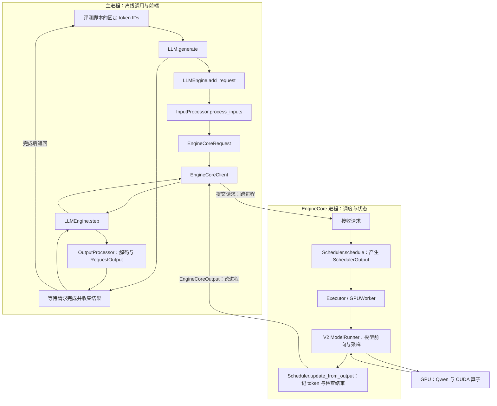

# vLLM 基线验证与性能评测

本文用同一份 Qwen2.5-0.5B-Instruct 权重和 token 输入，

## 实验环境

## 输入准备

```shell

```

用本仓库环境的 tokenizer 将 20 条消息经聊天模板转换为 `prompts.jsonl`，另生成 128-token 的 `bench-input.jsonl`。三个后端直接读取 `prompt_token_ids`，避免把模板或分词差异混入模型执行差异。

## 正确性对照

[统一运行脚本](../benchmarks/inference/run_inference.py) 对三后端设置 BF16、greedy、单请求、最大上下文 2048，以及固定生成 16 个 token 并忽略 EOS。HF 使用 eager attention；vLLM 设置 `max_num_seqs=1`、`max_num_batched_tokens=1024`、`gpu_memory_utilization=0.70`、chunked prefill 开启、prefix caching 关闭、`enforce_eager=True` 和 `generation_config="vllm"`。`enforce_eager` 关闭编译和 CUDA Graph。


[对照脚本](../benchmarks/inference/compare_outputs.py) ；报告存在 `differences` 时仍会正常结束。本机原始结果保存在 `` 和 `comparison.json`，观察如下：

| 对照 | 完整序列一致 | 首处分歧示例 |
| --- | ---: | --- |
| HF → mini_llm | 20/20 | 无 |
| HF → vLLM | 7/20 | `p01` 的 `first_difference_index=3`，即第 4 个生成 token |

这些数字不表示回答准确率，也不表示 vLLM 推理错误。分析后续分歧时，必须在相同已生成前缀下重新比较，不能直接比较已经走向不同上下文的后续 logits。[一致性排查记录](推理输出一致性排查流程.md) 对本次 13 条分歧做了共同前缀重放与算子替换验证：BF16 下 RMSNorm、RoPE、打包投影 GEMM 和 FlashAttention 与 HF eager 的计算及舍入路径共同影响候选排序；

下表保留本次 HF 与 vLLM 的具体数值路径分析。首层 RMSNorm 是已观察到的第一处张量分歧；后续路径也会影响候选排序，不能将所有输出差异单独归因于首层。

| 路径                    | HF 参考执行与 vLLM 执行的具体差别                            | 为什么可能影响最终 token                                     | 两边的源码位置                                               |
| ----------------------- | ------------------------------------------------------------ | ------------------------------------------------------------ | ------------------------------------------------------------ |
| RMSNorm                 | HF 将 FP32 归一化结果先转换到 BF16，再乘同一份 learned weight；vLLM CUDA kernel 在较高精度下完成归一化与乘权重，随后转换输出。可近似理解为 `bf16(bf16(u) * w)` 与 `bf16(u * w)`，简化公式不覆盖 CUDA 归约的所有细节。 | 即使输入和权重相同，中间舍入时机不同也会使下一层输入略有差异；13 条目标位置在首层 RMSNorm 输出已出现分歧。 | [HF Qwen2](../.venv/lib/python3.12/site-packages/transformers/models/qwen2/modeling_qwen2.py) 第 246–253 行；[vLLM CUDA](../../vllm/csrc/layernorm_kernels.cu) 第 79–94 行。 |
| RoPE                    | 两边对 Q/K 做同样的旋转位置编码，但 HF 的分步乘加保留 BF16 中间舍入，vLLM CUDA 路径将参与旋转的数转换为 FP32 后计算，再写回低精度。诊断复用了同一份 vLLM cos/sin cache。 | 差异来自旋转的计算与舍入路径，不能解释成双方拿了不同的位置角度。 | [HF Qwen2](../.venv/lib/python3.12/site-packages/transformers/models/qwen2/modeling_qwen2.py) 第 113–137 行；[vLLM CUDA](../../vllm/csrc/pos_encoding_kernels.cu) 第 9–32 行。 |
| QKV 与 gate/up 矩阵乘法 | HF 分别执行投影；vLLM 把权重打包成较大的矩阵乘法，计算后再切分。诊断把核验过的同一组权重拆开，分别计算后拼回。 | GEMM 的形状、分块和累加顺序不同，BF16 结果可能不同；“合并”不表示偷偷换了权重。 | [HF Qwen2](../.venv/lib/python3.12/site-packages/transformers/models/qwen2/modeling_qwen2.py) 第 41–47、187–208 行；[vLLM Qwen2](../../vllm/vllm/model_executor/models/qwen2.py) 第 91–113、157–164、208–233 行。 |
| Attention               | HF eager 路径显式计算 QK 分数、mask、FP32 softmax 并转回 BF16，再乘 V；本机 vLLM 使用 FlashAttention 2，在融合/分块内核中完成这些计算。 | 即使 query 与分页缓存中的 K/V 相同，中间张量何时物化、精度和归约顺序不同，attention 输出仍可能不同。 | [HF Qwen2](../.venv/lib/python3.12/site-packages/transformers/models/qwen2/modeling_qwen2.py) 第 151–169 行；[vLLM FlashAttention](../../vllm/vllm/v1/attention/backends/flash_attn.py) 第 1177、1476–1488 行。 |

下面保留本机离线 `LLM.generate` 路径的职责图。它标出前端与 EngineCore 的进程边界；GPUWorker、ModelRunner、Scheduler 是职责不同的组件，不能仅按方框数量推断进程数量。



## 离线性能基线

性能负载固定为 128 个输入 token、32 个输出 token、忽略 EOS。仅测 vLLM eager、prefix caching 关闭时的顺序单请求调用；每个独立进程加载模型后预热 5 次，再对同一输入测 30 次，共运行 3 个进程。运行时保证 GPU 没有其他模型任务，并记录 `nvidia-smi` 与 vLLM 启动日志中的实际 runner、attention backend、显存和时钟/温度条件。

```bash
for run in 1 2 3; do
  nvidia-smi > "artifacts/inference/logs/bench-recheck-before-$run.txt"
  ~/Desktop/vllm/.venv/bin/python benchmarks/inference/run_inference.py \
    --backend vllm --inputs bench-input.jsonl \
    --output "vllm-bench-recheck-$run.json" \
    --max-new-tokens 32 --ignore-eos --warmups 10 --repeats 50 \
    2>&1 | tee "artifacts/inference/logs/vllm-bench-recheck-$run.txt"
done
```

从每份 JSON 的 30 个 `requests[].offline_call_ms` 取中位数；顺序输出吞吐为 `sum(len(token_ids)) / measurement_window_s`。本机已保存的三次结果见 `artifacts/inference/results/benchmark-summary.json`：

```bash
.venv/bin/python - <<'PY'
import json
from pathlib import Path
from statistics import median

root = Path("artifacts/inference/results")
for run in (1, 2, 3):
    result = json.loads((root / f"vllm-bench-recheck-{run}.json").read_text())
    requests = result["requests"]
    assert all(len(r["prompt_token_ids"]) == 128 and len(r["token_ids"]) == 32 for r in requests)
    latency = median(r["offline_call_ms"] for r in requests)
    throughput = sum(len(r["token_ids"]) for r in requests) / result["measurement_window_s"]
    print(run, f"{latency:.2f} ms", f"{throughput:.2f} token/s")
PY
```

| 独立运行 | 单请求调用中位数 | 顺序输出吞吐 |
| :-: | :--: | :--: |
| 1 | 163.84 ms | 194.44 token/s |
| 2 | 163.68 ms | 194.76 token/s |
| 3 | 163.74 ms | 194.57 token/s |

`offline_call_ms` 是一次同步 `LLM.generate` 调用的墙钟时间，包含 Python 与引擎开销；模型加载、5 次预热、结果解码及 JSON 写入不在测量窗口内。`model_load_s` 包含引擎初始化，不是纯权重读取时间。这组数据不能解释为 HTTP TTFT、ITL、高并发吞吐或 kernel 耗时。30 次请求也不足以稳定估计尾延迟；本阶段报告中位数和三次运行间的差异即可。复现时用上面的命令对新文件重新计算，不能直接沿用上表数字。

## 结论与复现边界

在本次固定输入与配置下，mini_llm 与 HF 的 20 条 greedy 序列一致；vLLM 有 13 条序列出现 token 分歧，已在共同前缀上定位到数值执行路径。vLLM 的顺序单请求离线基准约为 165–167 ms 中位调用时间、189–192 token/s 输出吞吐。重跑时以新 JSON 的 `inputs_sha256`、`environment`、请求数与输出长度，以及启动日志中的实际 backend 为准；模型 revision、软件版本、GPU 或负载变化后应重新记录结论。在线服务延迟、并发吞吐和更细的执行链测量分别见 [在线服务手册](vLLM在线服务与流式测量手册.md) 与 [执行链手册](vLLM执行链追踪与性能分析手册.md)。
